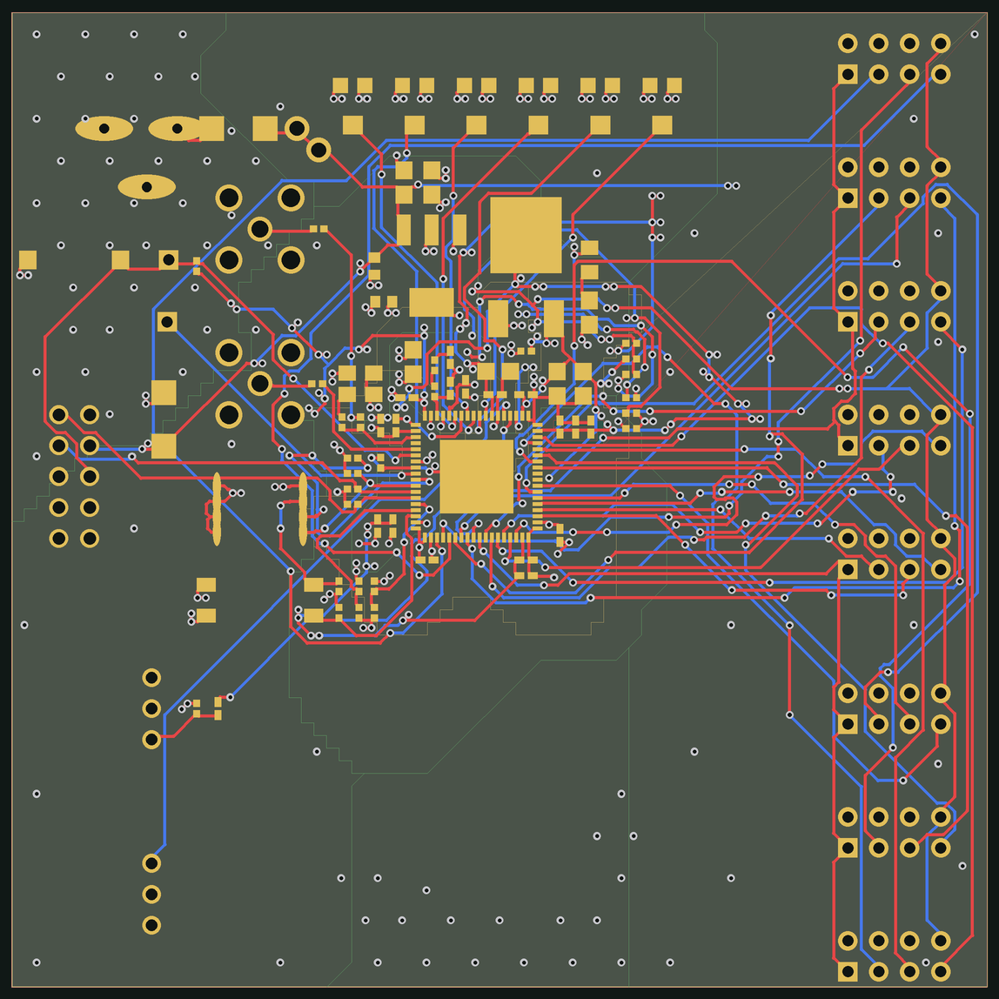

# EasyEDA Autorouter

An autorouter for EasyEDA Standard projects, written in Rust. It reads the project, routes all open connections with real track widths and vias, generates copper areas and writes a new project file that you open in EasyEDA again.



## Needs the EasyEDA source JSON, not the DSN

Export the project with **File > Export > EasyEDA source** and open the resulting `.json` file. A Specctra DSN export is not enough, because of technical limitations of the format:

- A DSN has no copper areas, solid regions, rectangles, circles, arcs, drill holes, board cutouts or vias that are part of a footprint. The router would route straight through them and EasyEDA would report DRC errors when you import the result.
- The routing result of a DSN workflow is an SES file, and an SES file cannot carry track widths or copper areas back into EasyEDA.

The JSON contains all of it, and the result is written back into a copy of the same JSON. Nothing that was already in the project is changed, new tracks, vias and areas are appended (the only exception are small parts, if you enable nudging).

## Features

- Routes two to four layer boards with the track width, clearance and via size of your project, per net if you set them.
- Reads everything that is copper or a hole on the board before routing and keeps clear of it: tracks, vias with their own size, pads, vias and tracks inside footprints, solid regions, rectangles, circles, arcs, text on copper layers, copper areas, drill holes and cutouts.
- Generates copper areas (pours) for the nets you assign to a layer, including inner layers used as planes, without gaps or overlaps between neighbouring areas. Every via and pad of a net is completely covered by its own area.
- Optionally fills all empty space on every layer with a ground area (net is selectable) and ties the layers together with stitching vias, only where a via fits and is fully covered.
- Differential pairs and length matching, several vias per layer change for power nets (never overlapping, falls back to fewer if there is no room).
- Last resorts for connections that stay open: short jumps on plane layers, a via inside a pad, and nudging small passives a little (off by default).
- Independent DRC and connectivity check of the result before you save it.
- Windows GUI with live preview, plus a command line mode.

## Copper areas


Areas are written as outlines with horizontal, vertical and 45 degree edges. EasyEDA cuts the clearances itself when you rebuild them (Ctrl+B).

## Speed


Measured on an Intel Core i7-13700KF, release build, full run including clean-up passes, copper areas, stitching vias and the DRC check.

| Board | Size | Layers | Parts | Connections | Time | Result |
|---|---|---|---|---|---|---|
| ADAU1452 DSP board | 81 x 80 mm | 4 | 85 | 219 | 24.6 s | all routed, 0 clearance errors |
| ESP32-S3 module board | 31 x 31 mm | 4 | 18 | 86 | 7.9 s | all routed, 0 clearance errors |

Independent nets are routed in parallel on copies of the board state. The result does not depend on how many cores you have.

## Workflow

1. In EasyEDA, place the parts, draw the board outline and set the design rules (track width, clearance, via size). Net specific widths can be set there or later in the autorouter.
2. **File > Export > EasyEDA source** and save the `.json` file.
3. Start `autorouter.exe` and open the file.
4. In **Layers**, choose which nets belong on which layer. For a ground plane put GND on an inner layer and set the layer type to plane. Power rails can share a plane layer, they split the room between them.
5. In **Nets**, set width, clearance and vias per layer change for power nets, or untick nets you want to route yourself.
6. Adjust the options below if needed and press **Route**. The report at the end lists clearance errors and open nets.
7. Save the result. In EasyEDA use **File > Open > EasyEDA source**, press **Ctrl+B** to rebuild the copper areas and run the DRC.

Command line:

```
autorouter.exe -nogui board.json -o board-routed.json --options settings.json
```

The settings of every run are saved next to the result as `board-routed.options.json` and can be loaded again with `--options`. `autorouter.exe -nogui --help` lists all switches.

## Options

**Layers**

| Option | Meaning |
|---|---|
| Layer type | Traces and copper areas, or plane. A plane carries no traces, its nets are reached through vias. |
| Nets for this layer | The nets that prefer this layer and get copper areas on it. |
| No traces on this layer | Nothing is routed here, vias may still pass through. |

**Nets**

| Option | Meaning |
|---|---|
| width, clearance | Per net override of the project rules. |
| vias per change | Vias side by side at every layer change, for example 2 to 4 for power. |
| group | Nets with the same name are routed together and length matched. |
| route | Untick to leave a net alone. |

**Design rules**: global minimums for trace width, clearance, via size and copper to board edge. Everything smaller is raised to these values. The default is a typical 4 layer economic fabrication process.

**Routing**

| Option | Meaning |
|---|---|
| Allow vias inside pads | Off by default. |
| Narrow a trace where the full width does not fit | Falls back to 75, 50 and 35 percent of the width and restores it wherever there is room. |
| Widen power traces up to | Lets rails with a width grow into free space. Not needed when copper areas carry the current. |
| Via cost | How much the router dislikes a via. Higher gives fewer vias and longer detours. |
| Bridge split planes/nets with up to N vias | Joins planes or nets that end up in pieces, with at most this many new vias per bridge. Global, applies to all layers. |
| Create copper areas for the nets assigned to a layer | The pours. They reach at most the given distance from the copper of their own net. |
| Fill the empty space of every layer | Fills free room with the fill net (default GND) on all layers and adds stitching vias on the given pitch. |
| Do not cut imported copper areas | Traces keep out of copper areas that are already in the project. |
| Clean-up passes | Re-routes nets after the first pass to shorten traces and remove vias. |
| Route differential pairs together | Pairs (+/-, _P/_N, DP/DN) are routed side by side with a fixed gap. |
| Last resorts | Jumps on plane layers, via inside a pad, and nudging small SMD parts (at most 3 part sizes, never ICs, connectors or through-hole parts). Only used for connections that stay open. |

## How it works

The board is turned into a routing grid. Each net is routed with an A* search over all layers, with costs for vias, wrong layers and crossing other nets' areas. If a net does not fit, the nets in its way are ripped up and routed again, followed by regional repairs and, as a last step, a restart with the failing nets first. After routing, traces are smoothed and centred on pads, vias are merged where they would overlap, and the copper areas are traced from the free space of each layer with edges shared between neighbours. A separate DRC pass measures every clearance and checks that each net is connected.

## Build

```
cargo build --release -p viewer
```

The program is `target/release/autorouter` (`autorouter.exe` on Windows). Prebuilt Windows and Linux binaries are on the releases page.

```
cargo test --release -p dsn -p router -- --test-threads=1
```

## Limits

- Always run the EasyEDA DRC after rebuilding the areas, it is the final judge.
- Copper areas are outlines. The cutouts around pads and traces are made by EasyEDA.
- Tested on 2 and 4 layer boards. Blind and buried vias are not supported.

## License

Unlicense, see `LICENSE`.
