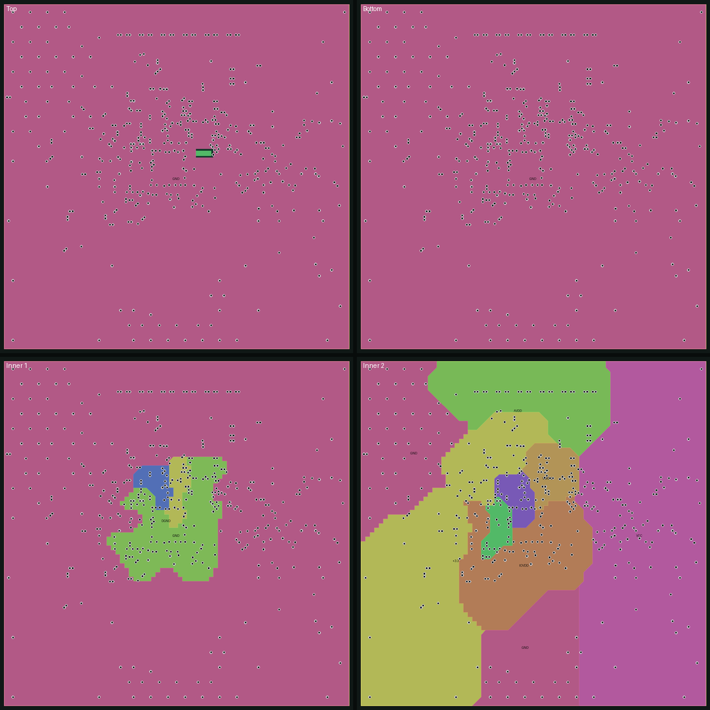
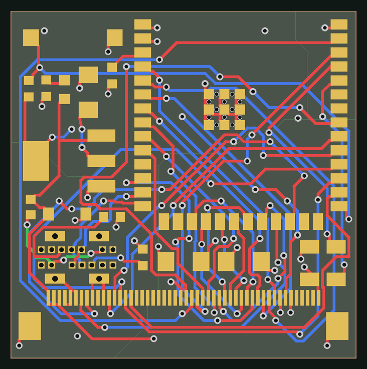
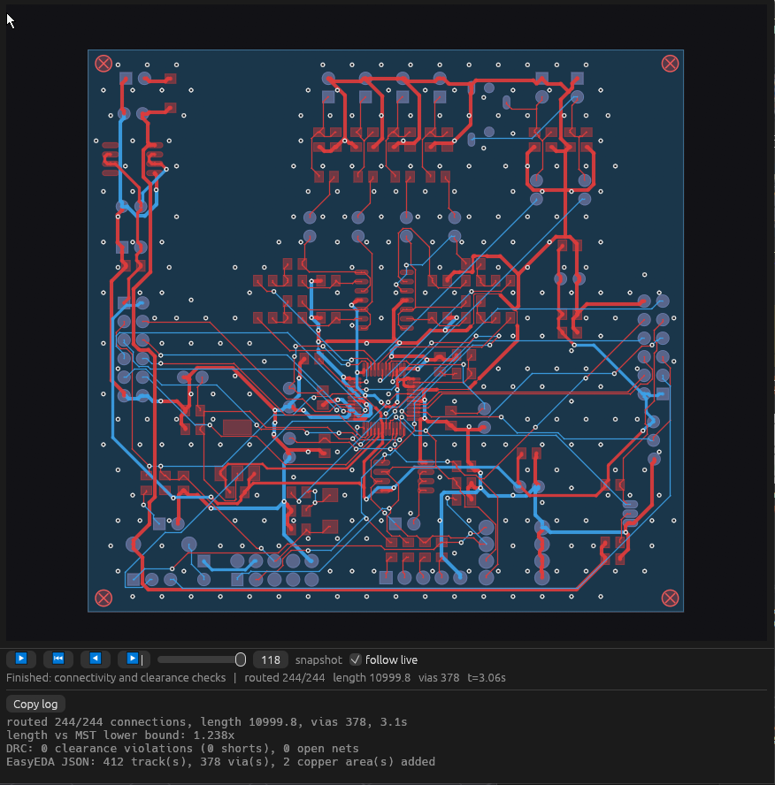
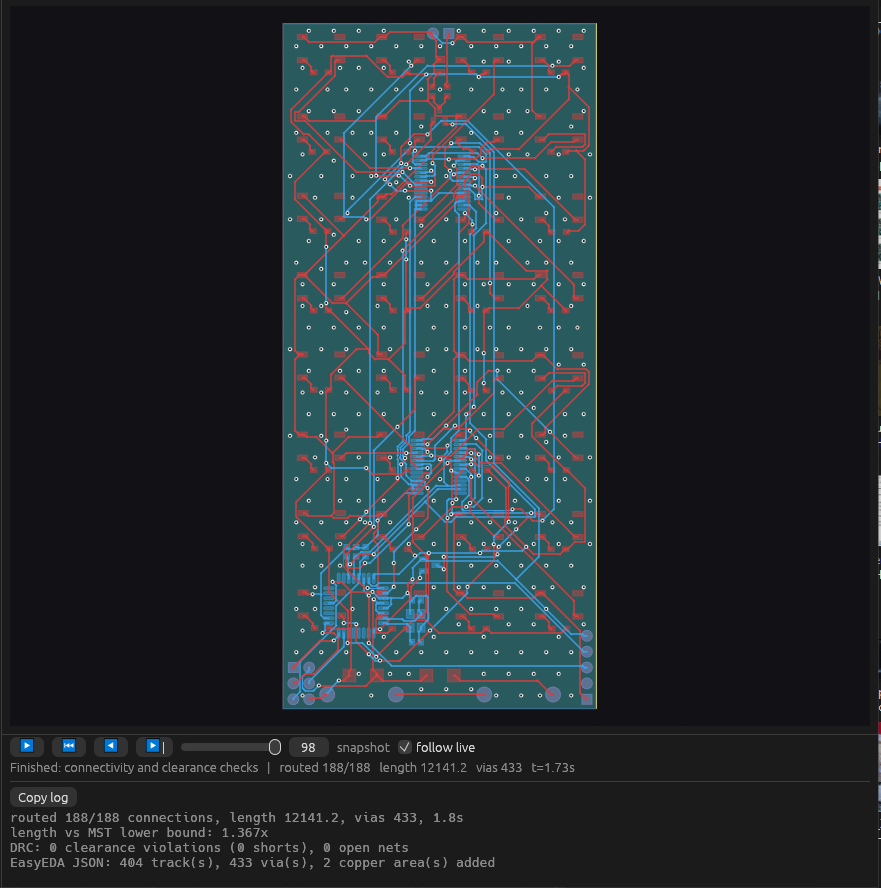

# EasyEDA Autorouter

An autorouter with an optional autoplacer for EasyEDA projects (Standard and Pro), written in Rust. It can place the parts, lets you move parts by hand, routes all open connections with real track widths and vias, generates copper areas and writes a new project file that you open in EasyEDA again.


## Needs the EasyEDA source JSON, not the DSN

Export the project with **File > Export > EasyEDA source** and open the resulting `.json` file. A Specctra DSN export is not enough, because of technical limitations of the format:

- A DSN has no copper areas, solid regions, rectangles, circles, arcs, drill holes, board cutouts or vias that are part of a footprint. The router would route straight through them and EasyEDA would report DRC errors when you import the result.
- The routing result of a DSN workflow is an SES file, and an SES file cannot carry track widths or copper areas back into EasyEDA.

The JSON contains all of it, and the result is written back into a copy of the same JSON. Nothing else in the project is changed, new tracks, vias and areas are appended (the only exception are small parts, if you enable nudging). The tracks and vias that were already on the board are routed around and stay in the saved file, the result is added to them. (Only the SES of a DSN input holds just the new routes, unless you enable `--include-existing`.) An EasyEDA file is saved as an EasyEDA file, there is no SES for it.

## EasyEDA Pro projects

EasyEDA Pro projects can be opened directly, no export is needed. Both file formats work: `.epro2` and the older `.epro` (one file per document inside the archive). The result is saved in the format that was opened. The router reads the PCB of the project (its footprints, pads with round and slot holes, tracks, vias, solid fills, copper pours, slot regions, board outline and cut-outs, design rules) and keeps clear of all of it. The result is saved as a new project file: the new tracks, vias and copper pours are appended to the PCB, everything else in the project (schematic, libraries, images, footprints, regions, pours, parts) stays as it was. The existing tracks and vias of the PCB are routed around and stay in the project.

```
autorouter.exe -nogui project.epro2 -o project-routed.epro2
autorouter.exe -nogui project.epro -o project-routed.epro
```

Notes for Pro projects:

- A project with several PCBs uses the one with the most parts.
- In the older `.epro` format arcs, circles, rectangles, ellipses and text on copper are reported and ignored (their layout is not known), the `.epro2` reader handles arcs and circles.
- Rules come from the active default rules of the PCB: track width, via size and the largest of the track, pad and via clearances. Per net rules of Pro are not read, set them in the **Nets** tab.
- Inner layers show up as `In1`, `In2`, ... in the layer lists.
- Pours are written as outlines. Rebuild the copper pours in EasyEDA Pro after opening the result and run the DRC.
- Not verified against real boards: parts on the bottom side (mirrored about the vertical axis), centre-point arcs (`CARC`, replaced by their chord) and pad shapes other than rectangle, oval and circle (replaced by their bounding rectangle). The output says so when it meets them.

## Features

- Routes two to four layer boards with the track width, clearance and via size of your project, per net if you set them.
- Reads everything that is copper or a hole on the board before routing and keeps clear of it: tracks, vias with their own size, pads, vias and tracks inside footprints, solid regions, rectangles, circles, arcs, text on copper layers, copper areas, drill holes and cutouts.
- Generates copper areas (pours) for the nets you assign to a layer, including inner layers used as planes, without gaps or overlaps between neighbouring areas. Every via and pad of a net is completely covered by its own area.
- Optionally fills all empty space on every layer with a ground area (net is selectable) and ties the layers together with stitching vias, only where a via fits and is fully covered.
- Differential pairs and length matching, several vias per layer change for power nets (never overlapping, falls back to fewer if there is no room).
- Last resorts for connections that stay open: short jumps on plane layers, a via inside a pad, and nudging small passives a little (off by default).
- Independent DRC and connectivity check of the result before you save it.
- Optional autoplacer and manual part moving in the same program, also when connections stay open after routing (see Placement).
- Windows GUI with live preview, plus a command line mode.

## Placement (optional)


The autoplacer is part of the program, nothing is placed unless you ask for it. Open a board, switch from **Routing** to **Placement** at the top of the window, and either let the program place the parts or move them yourself, or both.

- **Automatic placement** (*Place parts*): a constructive placement followed by simulated annealing on the weighted wire length, with hard rules: every part stays inside the board outline (without an outline you pick a size: no room to breathe, tight, normal, relaxed, or a fixed size), parts never overlap, and chips with many pins get extra room between each other. Decoupling capacitors are paired with the chip pin they serve and placed right at it. Parts that are locked in the file, and parts you locked or moved by hand, are never moved. Parts go to the front only (default), the back only, or both sides (Pro files).
- **Manual placement:** click a part, drag it, `R` / `Shift+R` turn it, `F` puts it on the other side, `L` locks or unlocks it, *Reset* puts it back. A part you move or turn locks itself, so a later automatic placement works around it. The ratsnest shows what is connected to what, with net names on the pins when you zoom in.
- **When routing leaves connections open:** the nets that stayed open are drawn in red in the Placement tab. Move the parts that are in the way, press *Use this placement for routing* and then *Route* again. Net settings, layer plan and rules are kept, earlier results are dropped.
- **Saving:** *Save placed board* writes `<name>-placed.json` / `.epro2`. By default the tracks and vias that are already in the file are removed (they no longer fit the moved parts); untick *Remove existing tracks/vias of the file* to keep them.
- **Command line:** `--place` places the board before routing, with `--place-sides front|back|both`, `--place-effort 1..10`, `--place-seed N`, `--place-clearance MM`, `--place-edge MM`, `--place-size noroom|tight|normal|relaxed`, `--place-no-rotate`, and `--save-placed FILE` to keep the placed board. `autoplacer-cli board.epro2 [options] [--svg after.svg]` places without routing.

Works on EasyEDA Standard `.json` and Pro `.epro2` files (not on a plain DSN).

## Fine-pitch pads

Next to a 0.35 mm pitch QFN the clearance leaves a trace only a very narrow band along the centre line of a pad. When no cell of the routing grid lies in that band, the pad would have no cell a trace can start from and would never be routed although the way out is free. Such a pad gets escape cells just outside it, and a route that starts or ends there is completed with a short stub that runs along the centre line of the pad first (checked with the exact geometry). On the ESP32-S31 test board this took 6 unrouted pads (STRAP_IO36, RMII_CRS_DV, ETH_MDIO and two +3V3 pins among them) down to 3 before any part was moved.

The airwires of the open connections join every cut-off piece of a net to the nearest piece that is connected (not to the first pin of the net), so a net with several open pieces shows all of its missing links. While hundreds of connections are still open, the early snapshots show the simple lines.

## When connections stay open

The router then tests other settings on the board and reports only the ones that helped, with the number of open connections, the clearance violations and the time they took: taking an open net off a shared plane layer (it is then routed with traces), allowing vias in pads, the `minimum` rule preset, nudging small parts. In the program they are listed below the log with an **Apply** button (then press Route); on the command line they are printed as `suggestion:` lines (`--no-suggest` skips the tests). The log and the clickable list of clearance errors and open nets are two tiles next to each other, drag the divider (and the top edge of the panel) to change their size.

## Copper areas



Areas are written as outlines with horizontal, vertical and 45 degree edges; a diagonal edge is one straight line, only near a via or pad that needs it the outline follows the grid more closely. EasyEDA cuts the clearances itself when you rebuild them (Ctrl+B).

## Speed



Measured on an Intel Core i7-13700KF, release build, full run including clean-up passes, copper areas, stitching vias and the DRC check.

| Board | Size | Layers | Parts | Connections | Time | Result |
|---|---|---|---|---|---|---|
| ADAU1452 DSP board | 81 x 80 mm | 4 | 85 | 219 | 24.6 s | all routed, 0 clearance errors |
| ESP32-S3 module board | 31 x 31 mm | 4 | 18 | 86 | 7.9 s | all routed, 0 clearance errors |

With the adaptive routing grid (0.2 mm, see How it works) most boards are routed in a few seconds. Two more boards of the current version, as shown in the program:





The timings in the table above are from an earlier version and were not measured again.

Independent nets and repair trials run in parallel on the CPU. The router sizes the worker pool to the available logical cores and the memory needed for the board grid. `AR_THREADS` can lower the worker count.

## Workflow

1. In EasyEDA, place the parts, draw the board outline and set the design rules (track width, clearance, via size). Net specific widths can be set there or later in the autorouter.
2. **File > Export > EasyEDA source** and save the `.json` file.
3. Start `autorouter.exe` and open the file.
4. In **Layers**, choose which nets belong on which layer. For a ground plane put GND on an inner layer and set the layer type to plane. Power rails can share a plane layer, they split the room between them. Every SMD pad of a plane net gets its via into the plane before anything is routed (inside the pad, half over its edge or beside it with a short stub, as far as *Vias on pads* allows), so those pads need no traces. This also holds for a net set to *no route*: its plane pads still get their vias.
5. In **Nets**, set width, clearance and vias per layer change for power nets, or untick nets you want to route yourself.
6. Adjust the options below if needed and press **Route**. The report at the end lists clearance errors and open nets.
7. Save the result. In EasyEDA use **File > Open > EasyEDA source**, press **Ctrl+B** to rebuild the copper areas and run the DRC.

Command line:

```
autorouter.exe -nogui board.json -o board-routed.json --options settings.json
```

The settings of every run are saved next to the result as `board-routed.options.json` and can be loaded again with `--options`. `autorouter.exe -nogui --help` lists all switches.

## Options

**Layers**

| Option | Meaning |
|---|---|
| Layer type | Traces and copper areas, or plane. A plane carries no traces, its nets are reached through vias. |
| Nets for this layer | The nets that prefer this layer and get copper areas on it. |
| No traces on this layer | Nothing is routed here, vias may still pass through. |

**Nets**

| Option | Meaning |
|---|---|
| width, clearance | Per net override of the project rules. |
| vias per change | Vias side by side at every layer change, for example 2 to 4 for power. |
| group | Nets with the same name are routed together and length matched. |
| route | Untick to leave a net alone. |

**Design rules**: global minimums for trace width, clearance, via size and copper to board edge. Everything smaller is raised to these values.

- When an EasyEDA file is imported, its own design rule is used (the `DRCRULE` of a Standard file, the default rules of a Pro PCB): clearance, via diameter and via hole become the global values, not the defaults or the choice of the last board. The track width of a file is the default width of the traces, not a minimum, so the minimum trace width (the floor for narrowing a trace as the last option) stays as it was, never above the file's width. Rule switches on the command line (`--rules`, `--min-*`) and `--options` files win over the file.
- **Make vias exactly the minimum diameter** (default on, `--project-via` turns it off): vias are made as wide as the via diameter of the rules (nets with a via of their own override keep it). With it off the via of the project is used and the minimum only raises it (a project via of 0.61 mm then stays 0.61 mm). The drill is the via hole of the rules, never leaving less than 0.1 mm of ring around it (JLCPCB: diameter >= hole + 0.1).
- **Presets** (`--rules NAME`, buttons in the GUI): `cheapest` JLCPCB, no extra charge on any layer count (0.127 trace/space, via 0.45 / hole 0.30), `economic` (the default: 0.09, via 0.45 / hole 0.20, a hole under 0.3 is free on multilayer boards only), `minimum` JLCPCB absolute minimum (0.09, via 0.30 / hole 0.20, copper to edge 0.2, extra charges), `relaxed` (0.2, via 0.60 / hole 0.30, edge 0.5). Check the numbers against the current JLCPCB capability page before ordering.
- **Stitching vias** (`--stitch-pitch-mm`, `--stitch-near-mm`): only placed within 3 mm of a pad, trace or via, so empty areas stay free of vias (`--stitch-near-mm 0` = everywhere on the grid).

**Routing**

| Option | Meaning |
|---|---|
| Vias on pads | `never` (default), `half over the edge` (`--vias-at-pad-edge`: the centre of a via stays outside the pad, the via overlaps it) or `inside the pad` (`--allow-vias-in-pads`, may cost extra at the fabricator). |
| Power net | A column of the net list (`--power NET,..` / `--not-power NET,..`). Preset by the name: `+5V`, `-12V`, `+3V3`, `3V3`, `GND`, `AGND`, `VCC`, `VDD`, `VSS`, `VEE`, `VBUS` ... A power net takes part in the copper areas, the ground fill and the plane vias also when its *route* box is unticked (an unrouted net used to be ignored by them). |
| Narrow a trace where the full width does not fit | Last option. A trace first keeps its full width and goes around obstacles (as long as the path is at most "Longest detour at full width" times the straight distance, plus 10 mm). Only when that fails it is tried at 75 %, then 50 %, then the minimum trace width, and the full width is restored wherever there is room. |
| Pull traces tight after routing | `--tighten` (0/45/90 degree pieces) or `--tighten-free` (any angle). Every routed wire is pulled to the shortest path around what is in the way: vertices that can be bypassed with a straight piece are dropped and the others slide toward the line between their neighbours as far as the exact clearances allow. Ends, vias, junctions and any copper of the net that a wire touches on its way stay connected. On the ESP32 test board the total trace length drops by 1.3 % (45 degree pieces) and 4.4 % (any angle) in under 0.1 s. |
| Longest detour at full width | `--max-detour`, default 3. 0 = any detour is accepted before narrowing. |
| Single sided board | `--single-sided` (`--single-layer NAME`). One copper layer, no vias at all: no layer changes, no via-in-pad, no jumps, no bridging or stitching vias, no multi-via changes, no differential-pair coupling, copper areas on that layer only. The layer is the one with the most SMD pads (bottom on a tie). Pads that exist only on the other layer cannot be reached and stay open (the output says how many). |
| 0 ohm resistors as the last resort | Single sided only, on by default (`--no-jumpers`, `--jumper-sizes 0805,1206`, default 0402,0603,0805,1206). A connection that has no path at all is routed again with hops: two pads of a 0402, 0603, 0805 or 1206 resistor (smallest that fits) on both sides of the traces in the way. The traces pass under the body between the pads, so the gap has to hold them with their clearance. The result is kept only if the exact pads keep all clearances. The Standard JSON output contains the parts (footprint with two pads on the net); every run also writes `<result>.jumpers.json` with net, size, position (mm and mil, y up) and angle. A Pro project gets the tracks up to the pad places but not the parts (a Pro part is a component that points at footprint and device documents inside the project, which this writer cannot create): place them from the list, which has the LCSC number of each part. Land patterns and parts (taken from the EasyEDA/LCSC footprints, all JLCPCB Basic 0 ohm): 0402 C17168 (pad pitch 0.866 mm, gap between the pads 0.30 mm), 0603 C21189 (1.507 / 0.70 mm), 0805 C17477 (2.000 / 0.87 mm), 1206 C17888 (2.958 / 1.75 mm). |
| Widen power traces up to | Lets rails with a width grow into free space. Not needed when copper areas carry the current. |
| Via cost | How much the router dislikes a via. Higher gives fewer vias and longer detours. |
| Bridge split planes/nets with up to N vias | Joins planes or nets that end up in pieces, with at most this many new vias per bridge. Global, applies to all layers. |
| Create copper areas for the nets assigned to a layer | The pours. They reach at most the given distance from the copper of their own net. |
| Fill the empty space of every layer | Fills free room with the fill net (default GND) on all layers and adds stitching vias on the given pitch. |
| Do not cut imported copper areas | Traces keep out of copper areas that are already in the project. |
| Also write the existing wiring to the SES | DSN input only (`--include-existing`): the SES holds only the new routes unless this is on. An EasyEDA JSON or Pro file always keeps what is on the board. |
| Clean-up passes | Re-routes nets after the first pass to shorten traces and remove vias (0.1 to 0.3 s on a 260 connection board; most of the run time is the first routing and the repair of connections that stay open). |
| Route differential pairs together | Pairs (+/-, _P/_N, DP/DN) are routed side by side with a fixed gap. |
| Last resorts | Jumps on plane layers, via inside a pad, and nudging small SMD parts (at most 3 part sizes, never ICs, connectors or through-hole parts). Only used for connections that stay open. Nudging (option **Nudge small parts, then route again**) is a local repair. Last of all it pushes and shoves: the open net is routed through the crowded spot on a field where routed copper only counts at 80, 55 or 30 percent of its clearance, then every via and every trace vertex of the nearby nets is a movable node and each clearance violation pushes the piece away from what it hits, which pushes the next piece in turn (traces move with the vias they end in, pads and wire ends on pads stay), until everything fits again or at most 3 mm of shoving is used up; the exact clearances and the connectivity of every moved net are checked and everything is put back otherwise. Before that:  routed vias of other nets next to the gap of an open net are moved a little, alone or several together by the same offset (with the wires that end in them), and the open net is routed again; small parts (EasyEDA JSON) are moved one at a time, each move re-routing only what it touches. Up to 16 part moves by default (`--nudge-attempts`), 2.5 minutes for all of it. When 8 or fewer connections are open, this is tried before the whole board is routed again; with 2 or fewer left afterwards the whole board is not routed again. |

## How it works

The board is turned into a routing grid. The grid is adaptive and not an option: 0.2 mm, or half the track pitch (width + clearance) of the design rules if that is smaller. Connections that stay open are searched again on finer local grids; if that is not enough, the whole board is routed again on a grid of a quarter of the pitch, and last with traces searched narrow first. Only the last run gets the full repair effort. A retry starts from the best result so far: every route that worked is kept (so an arrangement that took effort to find, such as the escape of a fine-pitch IC, is not lost) and only what is open is repaired on the finer grid; only when that does not finish is everything routed again from scratch. The clean-up passes also look again at nets that use a via although all their pads are on one layer, and keep a via-free path when there is one. Differential pairs are routed side by side with the clearance of their nets as the gap. Each net is routed with an A* search over all layers, with costs for vias, wrong layers and crossing other nets' areas. If a net does not fit, the nets in its way are ripped up and routed again, followed by regional repairs and, as a last step, a restart with the failing nets first. After routing, traces are smoothed and centred on pads, vias are merged where they would overlap, and the copper areas are traced from the free space of each layer with edges shared between neighbours. A separate DRC pass measures every clearance and checks that each net is connected.

Open signal connections also get adaptive local searches at half and quarter of the main grid spacing, including during regional repairs. The search window grows to allow detours, with limits on memory and search work. Accepted routes retain their finer coordinates and must pass geometric clearance and connectivity checks; trace widths, via sizes and layer restrictions are preserved.

When nudging is enabled, the preview identifies each attempted move and shows the pads at their trial positions. Rejected moves restore the best layout. Candidates favour small movements and try different nearby parts; a move is kept only if it improves the result without increasing clearance errors.

## Build

```
cargo build --release -p viewer
```

The program is `target/release/autorouter` (`autorouter.exe` on Windows). Prebuilt Windows and Linux binaries are on the releases page.

```
cargo test --release -p dsn -p router -- --test-threads=1
```

## Limits

- Always run the EasyEDA DRC after rebuilding the areas, it is the final judge.
- Copper areas are outlines. The cutouts around pads and traces are made by EasyEDA.
- Tested on 2 and 4 layer boards. Blind and buried vias are not supported.

## License

Unlicense, see `LICENSE`.
